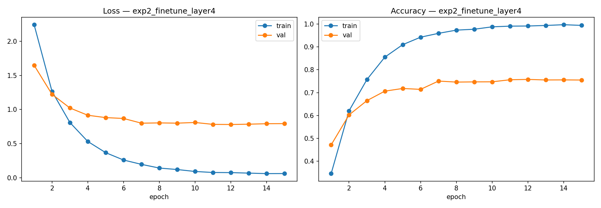
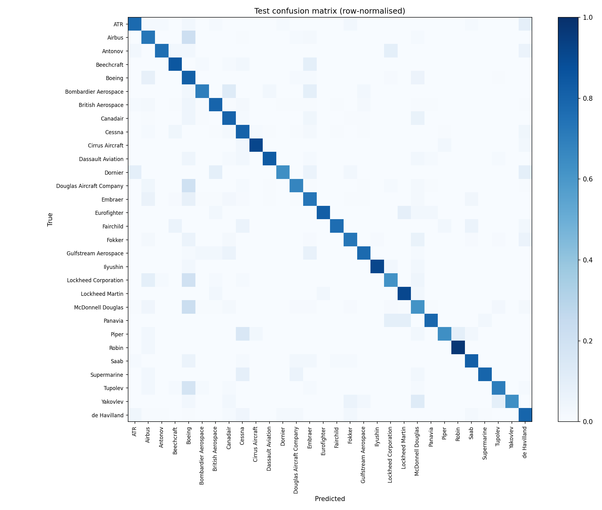
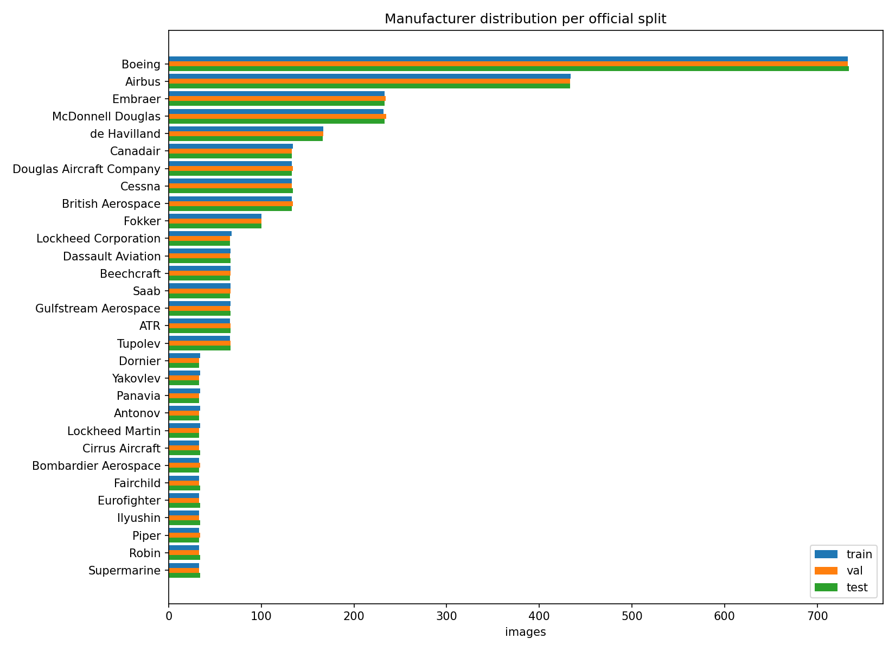
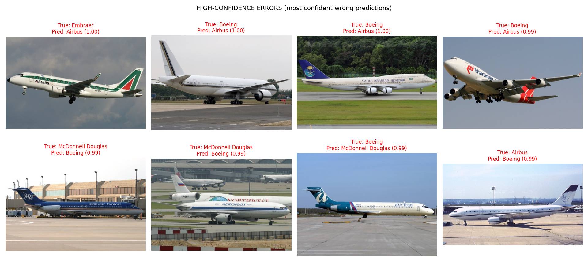

# Aircraft manufacturer classification (FGVC-Aircraft, PyTorch)

I trained a ResNet-18 to tell which of 30 manufacturers built the aircraft in a photo (Boeing, Airbus, Embraer, Cessna, ATR and so on). It uses the official FGVC-Aircraft manufacturer splits, so the numbers below come from the dataset's own train/validation/test partition.

On the test set the best model gets **76.4% accuracy and 0.794 macro-F1**. Always guessing the most common class (Boeing) gets 22.0% accuracy and 0.012 macro-F1, and logistic regression on tiny 32x32 pixel images gets 26.4% and 0.242.

Everything was run in Google Colab on a free T4 GPU. The whole pipeline is in [`aircraft_classification.ipynb`](aircraft_classification.ipynb), saved with its outputs. A longer write-up is in [`docs/report.md`](docs/report.md).

## Data

[FGVC-Aircraft 2013b](https://www.robots.ox.ac.uk/~vgg/data/fgvc-aircraft/) from the Visual Geometry Group at Oxford. For the manufacturer task the official split is 3,334 training, 3,333 validation and 3,333 test images over 30 classes. I checked the split files for missing images, malformed lines, duplicate ids and ids shared between splits and found none.

Two things shape the project:

- The classes are very uneven: Boeing has 733 training images (22% of the set) and the smallest classes have 33.
- Every image has a 20 px copyright strip at the bottom. I crop it off so the model cannot learn from the text.

The images are not in this repo. The dataset is licensed for non-commercial research use, so download it from the link above (the notebook does this for you).

## What I did

- Resized the photos once into a cache, then loaded them at 224x224 with ImageNet normalisation. Training uses a random resized crop and horizontal flip; validation and test are deterministic.
- Wrote a small custom `Dataset` that validates paths and labels before training starts.
- Used two baselines (majority class, logistic regression on 32x32 pixels).
- Trained ImageNet-pretrained ResNet-18 with a new 30-way output layer in three ways: only the new layer (exp1), new layer plus the last residual block `layer4` (exp2), and the same as exp2 with a class-weighted loss (exp3).
- Trained with AdamW, cosine learning-rate decay, early stopping and best-checkpoint saving on validation macro-F1. Macro-F1 because accuracy is misleading with this class imbalance.
- Picked the model on validation, then evaluated it on the test set once.

## Results

Validation (used to pick the model), seed 42, one run each:

| experiment | best epoch | val macro-F1 | val accuracy | train time |
|---|---|---|---|---|
| exp1: frozen backbone, train new layer | 12 | 0.4431 | 0.4650 | 5.4 min |
| exp2: fine-tune `layer4` + new layer | 12 | 0.7857 | 0.7579 | 7.7 min |
| exp3: exp2 with class-weighted loss | 14 | 0.7801 | 0.7240 | 8.0 min |

Test set, evaluated once with exp2:

| model | accuracy | macro precision | macro recall | macro F1 | weighted F1 |
|---|---|---|---|---|---|
| majority class (always Boeing) | 0.2202 | 0.0073 | 0.0333 | 0.0120 | 0.0795 |
| logistic regression, 32x32 pixels | 0.2637 | 0.2935 | 0.2175 | 0.2418 | 0.2621 |
| ResNet-18, `layer4` fine-tuned | 0.7636 | 0.8240 | 0.7704 | 0.7935 | 0.7637 |

788 of the 3,333 test images are misclassified. Predicting the whole test set took 10.8 s (3.2 ms per image, including loading the image). Per-class numbers are in [`results/per_class_report_test.csv`](results/per_class_report_test.csv).

A few things I noticed:

- Fine-tuning `layer4` made a big difference over the frozen backbone. The frozen run was still improving at its last epoch, so it was probably cut short and the gap is partly a training-budget effect.
- Exp2 reaches about 99% training accuracy while validation stays around 75-76%, so it overfits the small training set.
- Class weights did not help in this run.
- Most errors involve Boeing or Airbus: 45% of the 788 mistakes are predictions of one of those two. Biggest confusions (true -> predicted): Airbus -> Boeing (92), Boeing -> Airbus (60), McDonnell Douglas -> Boeing (51), Boeing -> McDonnell Douglas (41). The model over-predicts Boeing (precision 0.708, recall 0.815).
- Larger classes tended to score lower (Spearman -0.47 between class size and F1). McDonnell Douglas is the weakest class (F1 0.621); Robin (0.943), Ilyushin (0.939) and Cirrus Aircraft (0.912) are the strongest. The small classes only have about 33 test images, so their scores are noisy.
- The model is less sure when it is wrong (mean confidence 0.62 vs 0.85 when right), but some errors are made with 99%+ confidence.

<p>
 
</p>
<p>
 
</p>

Left to right: training curves of the selected model, confusion matrix on the test set, class distribution per split, and the test images the model got wrong with the highest confidence.

## Running it

**Notebook.** Open `aircraft_classification.ipynb` in Colab (File -> Open notebook -> GitHub, or upload it), choose a T4 GPU and run it top to bottom. It downloads the dataset if needed. On a T4 the preprocessing cache took about 3 minutes and training all three experiments about 21 minutes. It also runs on CPU with a lighter setting (fewer epochs), but I only ran it on GPU.

**Trained model.** `best_model.pt` (about 45 MB, the exp2 checkpoint) is attached to the Releases page of this repo instead of being committed. With it you can classify your own photos:

```bash
pip install -r requirements.txt
python predict.py --weights best_model.pt my_photo.jpg
```

Example from the notebook, using an image from the test split (so a demo, not an independent test). The true label was Boeing:

```
  Boeing                     92.1%
  Airbus                      7.1%
  McDonnell Douglas           0.2%
```

Versions used in Colab: Python 3.13, torch 2.11, torchvision 0.26, numpy 2.1, pandas 2.2, scikit-learn 1.6 (full list in `results/environment_versions.txt`).

## Limitations

- One run per setup (seed 42), so no error bars. Small differences between experiments could be noise.
- I used the validation set to choose among three setups, so validation scores are a bit optimistic. The test set was used once.
- Some classes have only about 33 test images.
- I did not test on photos from outside the dataset, so I would not expect 76% on arbitrary phone photos. The model may also lean on airline liveries or backgrounds, which I did not check.
- The "manufacturer" label groups very different aircraft together.

## What I would try next

Several seeds with mean and standard deviation, a longer frozen run for a fairer comparison, unfreezing `layer3`, stronger augmentation against the overfitting, a larger backbone, and the family (70 classes) and variant (100 classes) versions of the task.

## References

- S. Maji, E. Rahtu, J. Kannala, M. Blaschko, A. Vedaldi, *Fine-Grained Visual Classification of Aircraft*, arXiv:1306.5151, 2013.
- K. He, X. Zhang, S. Ren, J. Sun, *Deep Residual Learning for Image Recognition*, CVPR 2016.
- I. Loshchilov, F. Hutter, *Decoupled Weight Decay Regularization*, ICLR 2019.

The code is under the MIT license (see `LICENSE`). The license does not cover the FGVC-Aircraft images.
